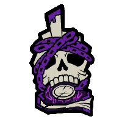

<p align="center">
  

## About the project

The name of this fan project is **The Middle Grudge** an application dedicated to recreate the book that The Middle holds, This organization is one of the Five Fingers that govern the slums of the City called "Backstreet" in the universe created by Project Moon.

The goal is to collect the characters and groups from Project Moon's canon who have earned The Middle's anger, recording what happened and the reasons behind each conflict.

## To run it locally
### Requirements

- **Node.js 22.12 or newer.** Node 20 is also supported from version 20.19 onward.
- **npm**, included with Node.js.
- **Git** to clone the repository.

### Installation and startup

```bash
git clone https://github.com/Alx370/The-Middle-Grudge.git
cd The-Middle-Grudge
npm ci
npm run dev
```

If you already have the repository, start with `npm ci` from the project directory. This installs the dependency versions recorded in `package-lock.json`.

Open the local URL printed in the terminal, usually **http://localhost:5173**. If that port is busy, Vite selects another one.
The current application runs entirely in the browser and requires no backend or environment variables.

Built with **React**, **Vite**, and **CSS**, with **Oxlint** for code checks.

## Inspiration and credits

The world, characters, artwork, and music that inspire this project belong to their respective creators. **Limbus Company** and the universe of **Project Moon** are the inspiration behind The Middle Grudge.
